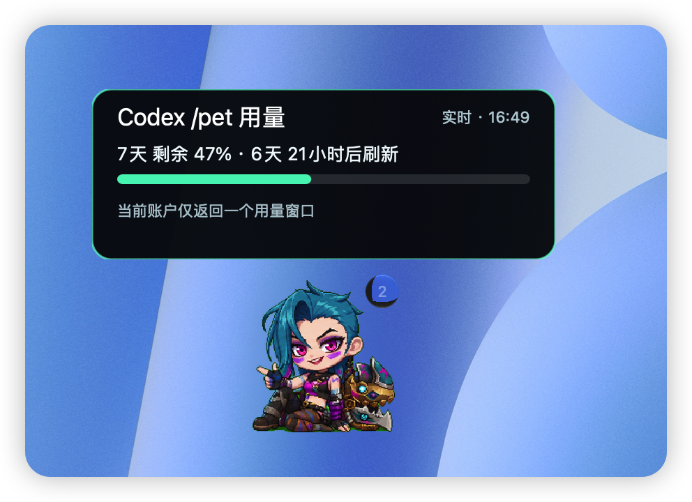

# Codex /pet 用量伴随层

这是一个从零写的极简伴随层，用来给 Codex Desktop 的 `/pet` 显示实时 Codex 剩余用量。

它不修改 Codex，也不复制参考项目代码。它只读取本机 Codex 状态文件定位宠物，并使用本机 Codex 登录态查询用量。

## 效果预览

### 悬停显示额度圆环

鼠标移动到 Codex `/pet` 宠物上时，立即显示当前额度进度。


### 悬停 3 秒显示用量卡片

保持悬停 3 秒后，圆环自动隐藏并显示剩余额度、刷新时间和数据状态。



## 原项目与署名

本项目基于 [Jimmy-asks-AI/codex-pet-usage](https://github.com/Jimmy-asks-AI/codex-pet-usage) 的使用场景进行扩展，原项目作者为 [Jimmy-asks-AI](https://github.com/Jimmy-asks-AI)。

当前仓库补充了 macOS Swift/AppKit 适配版、Hammerspoon 悬浮层，以及宠物悬停圆环和延迟用量卡片交互。

`2.0.0` 针对内置于 `ChatGPT.app` 的 Codex `26.1007` 状态格式重新实现定位和生命周期管理。

## 平台

- Windows：使用仓库根目录的 `.bat` / `CodexPetUsageOverlay.ps1`。
- macOS：使用 `macos/` 目录里的 Swift/AppKit 适配版，说明见 `macos/README-macOS.md`。
- macOS Hammerspoon：使用 `hammerspoon/codex-pet-usage-overlay.lua`。这是本仓库当前推荐的 macOS 运行方式。

## 功能

- 鼠标移动到 Codex `/pet` 身上时立即显示透明用量圆环；移开后立即隐藏。
- 连续悬停宠物 3 秒后显示用量卡片，同时隐藏圆环；鼠标移开后自动收起。
- 只读取当前活动显示器的宠物坐标，自动适配 Retina 缩放与多显示器坐标。
- 自动接管旧画布并停止旧 Swift 伴随层，避免出现第二个独立圆环。
- 外圈显示 5 小时窗口剩余用量。
- 内圈显示 7 天窗口剩余用量。
- 中文显示剩余百分比和刷新倒计时。
- 实时接口失败时，尝试读取本地 `logs_2.sqlite` / `logs_1.sqlite` 中的 `codex.rate_limits` 事件。
- 支持当前用户开机自启。
- 提供未签名的 macOS `.pkg` 安装包构建脚本。

## macOS Hammerspoon 版

需要先安装并运行 [Hammerspoon](https://www.hammerspoon.org/)。将脚本复制到本机配置目录：

```zsh
mkdir -p ~/.hammerspoon
cp hammerspoon/codex-pet-usage-overlay.lua ~/.hammerspoon/
```

然后在 `~/.hammerspoon/init.lua` 末尾加入：

```lua
local ok, err = pcall(require, "codex-pet-usage-overlay")
if not ok then
  hs.printf("Codex pet usage overlay failed: %s", tostring(err))
end
```

在 Hammerspoon 菜单中选择 `Reload Config` 后，打开 Codex Desktop 的 `/pet`：

- 鼠标悬停宠物时立即显示双层用量圆环；离开后隐藏。
- 连续悬停 3 秒后显示用量卡片，并自动隐藏圆环；可在宠物和卡片之间移动查看。
- 外圈为 5 小时窗口，内圈为 7 天窗口。
- 每 30 秒优先查询 OpenAI 的用量接口；网络失败时回退到本地 Codex 日志。

脚本只从本机 `~/.codex/auth.json` 读取 access token，并只将它发送到
`https://chatgpt.com/backend-api/wham/usage` 查询当前用量。不要将 `auth.json`、
`.codex` 目录或任何数据库日志提交到仓库。

## macOS 未签名安装包

仓库提供 Hammerspoon 版的未签名 `.pkg` 构建脚本。构建时会下载并校验官方
Hammerspoon `1.1.1`，生成的安装包会一并携带它。构建并生成安装包：

```zsh
cd macos/pkg
chmod +x build-unsigned-pkg.sh scripts/postinstall resources/Uninstall.command
./build-unsigned-pkg.sh 2.0.0
```

安装包位于 `macos/pkg/dist/`。它只会安装本项目的 Lua 脚本，并在现有
`~/.hammerspoon/init.lua` 末尾增加一个带标记的加载块，不会覆盖已有配置。
因为包未签名，其他 Mac 首次安装时可能需要按住 Control 点击安装包，再选择“打开”。
卸载入口为：

```text
/Applications/Codex Pet Usage Overlay/Uninstall.command
```

### 使用发布版安装

1. 从 [GitHub Releases](https://github.com/w342229438/-/releases/latest) 下载 `CodexPetUsageOverlay-*-unsigned.pkg`。
2. 双击 `.pkg` 并完成系统安装流程。若 Mac 尚未安装 Hammerspoon，安装器会自动安装官方 Hammerspoon `1.1.1`；已有版本不会被替换。该版本要求 macOS 13 或更高。
3. 若 macOS 阻止打开，按住 Control 点击安装包，再选择“打开”。首次使用时，按 Hammerspoon 的提示授予所需的 macOS 权限。
4. 安装器会打开 Hammerspoon。随后打开 Codex Desktop 的 `/pet`，鼠标移到宠物上即可看到圆环；连续悬停 3 秒显示用量卡片。

从 `1.x` 升级时，安装器会停止并移除旧 Swift 后台伴随层，防止旧组件继续绘制第二个圆环；不会改动其他 Hammerspoon 模块。

安装器只写入 `~/.hammerspoon/codex-pet-usage-overlay.lua`，并在 `init.lua` 增加一个带标记的加载块。它不会修改 Codex 本体，也不会覆盖其他 Hammerspoon 配置。

要移除功能，运行：

```text
/Applications/Codex Pet Usage Overlay/Uninstall.command
```

## 运行

双击：

```text
Start.bat
Stop.bat
Status.bat
InstallStartup.bat
UninstallStartup.bat
```

或用 PowerShell：

```powershell
powershell -ExecutionPolicy Bypass -File .\CodexPetUsageOverlay.ps1 Start
powershell -ExecutionPolicy Bypass -File .\CodexPetUsageOverlay.ps1 Stop
powershell -ExecutionPolicy Bypass -File .\CodexPetUsageOverlay.ps1 Status
powershell -ExecutionPolicy Bypass -File .\CodexPetUsageOverlay.ps1 InstallStartup
powershell -ExecutionPolicy Bypass -File .\CodexPetUsageOverlay.ps1 UninstallStartup
powershell -ExecutionPolicy Bypass -File .\CodexPetUsageOverlay.ps1 SelfTest
```

可调参数：

```powershell
powershell -ExecutionPolicy Bypass -File .\CodexPetUsageOverlay.ps1 Start -PetPollMs 100 -HoverPaddingPx 24
```

## 开机自启

运行一次：

```powershell
powershell -ExecutionPolicy Bypass -File .\CodexPetUsageOverlay.ps1 InstallStartup
```

它会写入当前用户的 Windows 登录启动项：

```text
HKCU\Software\Microsoft\Windows\CurrentVersion\Run\CodexPetUsageOverlay
```

同时会在当前用户的 Startup 文件夹创建一个快捷方式作为兼容 fallback。下次重启登录 Windows 后，会自动执行 `Start`，不用再手动开启。

要取消自启：

```powershell
powershell -ExecutionPolicy Bypass -File .\CodexPetUsageOverlay.ps1 UninstallStartup
```

`Status.bat` 会显示 `StartupEnabled`、`StartupRegistry`、`StartupShortcut`，用来确认自启是否已安装。

## 数据与隐私

本工具读取：

- `%USERPROFILE%\.codex\.codex-global-state.json`
- `%USERPROFILE%\.codex\auth.json`
- `%USERPROFILE%\.codex\logs_2.sqlite` 或 `logs_1.sqlite`

实时用量只把本地 Codex access token 用于：

```text
https://chatgpt.com/backend-api/wham/usage
```

不会发送宠物图片、截图、prompt、仓库内容或日志正文到其他位置。

## 运行状态

运行时文件：

```text
%LOCALAPPDATA%\CodexPetUsageOverlay\overlay.pid
%LOCALAPPDATA%\CodexPetUsageOverlay\overlay.log
```

## 故障排查

- 没看到悬浮层：确认 Codex Desktop 里已经打开 `/pet`，然后把鼠标移动到宠物身上。
- 重启后没显示：先运行 `Status.bat`，确认 `StartupEnabled: True` 且 `Running: True`。
- 显示用量不可用：先运行 `Status.bat`，再看 `%LOCALAPPDATA%\CodexPetUsageOverlay\overlay.log`。
- 重复启动：`Start` 会复用已运行实例，不会启动多个。
- 要停掉当前进程：运行 `Stop.bat`。
- 要取消开机自启：运行 `UninstallStartup.bat`。

## 已知边界

- `wham/usage` 不是公开稳定 API，未来可能变化。
- 本地日志兜底依赖 Codex 日志里出现 `codex.rate_limits` 事件；如果没有事件，会显示不可用。
- 开机自启使用当前用户 `HKCU\...\Run`，并保留 Startup 快捷方式 fallback；如果需要延迟启动或管理员权限，再改 Task Scheduler。
